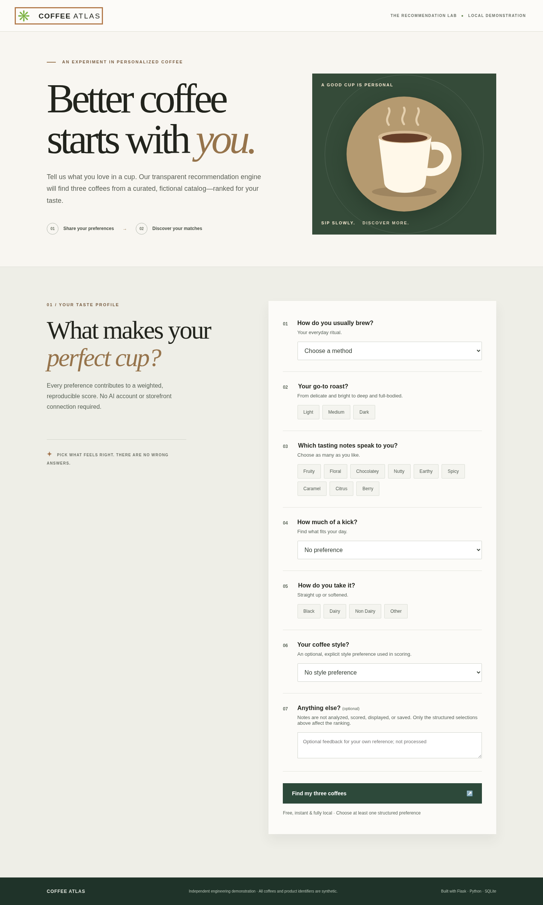
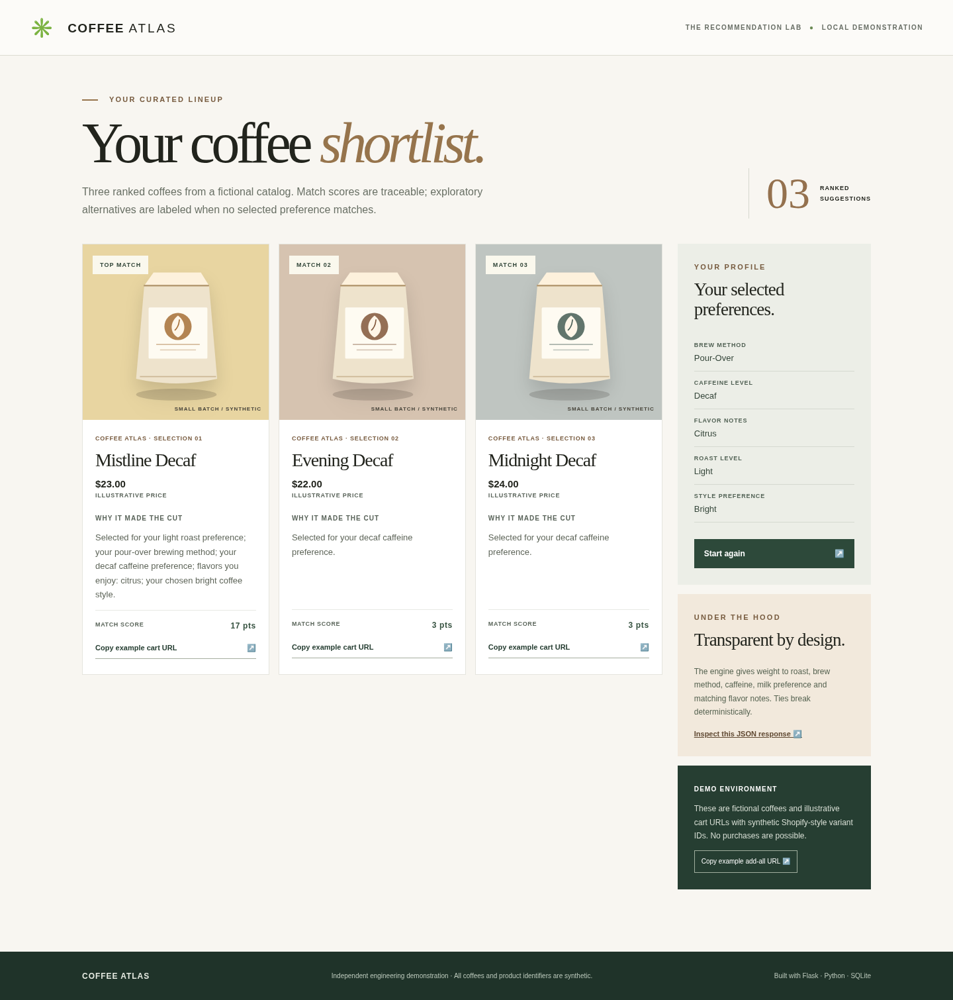

# Coffee Atlas — Coffee Recommendation Prototype

[](https://github.com/ryanrowe2/coffee-recommendation-prototype/actions/workflows/ci.yml)

**A local-first Flask application that turns coffee preferences into three explainable, deterministic product recommendations.**

**Hosted verification:** **265 passing tests, zero skips, 95.16% application coverage**, with all four required GitHub Actions checks green on `main` (Python 3.11/3.12/3.13 and Chromium). [Inspect the verified run](https://github.com/ryanrowe2/coffee-recommendation-prototype/actions/runs/43185857273).

An engineering portfolio case study developed from an earlier coffee-quiz prototype and an associated technical architecture proposal. The original project concept concerned a coffee quiz for a commerce storefront; this repository is an **independent demonstration**, not a live client website or production deployment.

## At a glance

| Focus | Implemented and verified |
|---|---|
| Application | Flask + Jinja, SQLite, responsive desktop/mobile interface |
| Recommendation engine | Deterministic top-three ranking with explainable score breakdowns and caffeine eligibility |
| Integrations and safety | Signed Typeform-compatible webhooks, validated inputs, CSRF, idempotent persistence |
| Quality evidence | [4/4 hosted CI checks](https://github.com/ryanrowe2/coffee-recommendation-prototype/actions/runs/43185857273), 265 passing tests, 95.16% full-app / 95.73% core coverage |
| Engineering detail | [Technical case study](docs/technical-case-study.md) · [Architecture](docs/architecture.md) · [Run locally](#quick-start) |

## Product walkthrough



## What it demonstrates

- **Backend engineering:** Flask application factory, validated REST endpoints, signed Typeform-compatible webhook intake, HTTP error handling, and configuration.
- **Recommendation logic:** a reproducible weighted ranker, input normalization, transparent score components, and stable tie-breaking.
- **Data integrity:** controlled synthetic product catalog, active-product filtering, SQLite persistence with enforced foreign keys, and transaction-safe webhook and local-form idempotency.
- **Full-stack UX:** a responsive preference form and a browser-accessible, server-rendered results page with three illustrated product cards.
- **Commerce integration design:** illustrative Shopify cart permalinks constructed from synthetic variant identifiers on the reserved `.example` domain; no storefront or checkout access is required.
- **Delivery discipline:** 265 passing tests in hosted Chromium certification, all four required CI checks passing, reproducible packaging, explicit tradeoffs, architecture, and operational documentation.

### Results experience



> **Screenshot provenance:** Verified Chromium desktop and mobile captures of the Flask application over live loopback HTTP, associated with the November 11, 2026 v1.0.3 certification. Comparison with earlier v1.0.0 captures found identical pixels and matching file hashes: these images show the unchanged interface, not a new visual redesign. See [current verification](docs/maintenance-verification-v1.0.3.md), [operations notes](docs/quality-and-operations.md) and `docs/screenshots/provenance.json`.

## Quick start

Requires **Python 3.11–3.13** with pinned direct Flask/Waitress versions and a working package index for installing dependencies. No Shopify, Typeform, or OpenAI account is needed.

```bash
python -m venv .venv
# macOS / Linux:
source .venv/bin/activate
# Windows PowerShell: .venv\Scripts\Activate.ps1
python -m pip install -e '.[dev]'
python -m app
```

Visit **http://127.0.0.1:5050**, select preferences, and submit. Explore the three ranked cards, matching explanations, and the associated JSON API via the results page.

For the pinned QA dependency snapshot used by CI and Docker, first install the pinned build tools with `python -m pip install -c requirements-verified.txt setuptools wheel`, then install with `python -m pip install --no-build-isolation -c requirements-verified.txt -e '.[dev]'`. The pinned local snapshot was validated on Python 3.12; GitHub Actions has since passed its Python 3.11/3.12/3.13 matrix. For browser certification, install Chromium with `python -m playwright install chromium`. An existing compatible Chromium executable can be selected with `COFFEE_BROWSER_PATH`. The earlier local certification used Playwright 1.56.0 with its official Chromium headless shell 141.0.7390.37 because the system browser's Unix-socket startup was restricted. The snapshot records the validation environment; `pyproject.toml` remains the supported dependency contract.

For Flask's development server, the verified alternate command is `python -m flask --app app:create_app run --host 127.0.0.1 --port 5050`.

The Waitress entry point binds to **127.0.0.1 only**. Generated SQLite records and a persistent, randomly generated local session signing key are stored in `.local_data/` (ignored by Git). The key preserves open forms across restarts. The app accepts only `localhost` and `127.0.0.1` HTTP hosts. For an isolated setup, use `APP_DB_PATH` to choose another file. The configured database path must not contain symbolic links; the local storage directory should be controlled by its owner.

### Tests

```bash
python -m pytest
python -m pytest --cov=app --cov-report=term-missing --cov-fail-under=80
python -m ruff check .
python -m ruff format --check .
python -m compileall -q app tests scripts
# Strict, fail-closed release check (requires Flask, Waitress, Ruff, Chromium):
python scripts/verify_release.py --offline  # offline checks: deliberately returns exit 2 (PARTIAL)
python scripts/verify_release.py            # strict gate: exit 0 only with full runtime tests
```

The [hosted GitHub Actions workflow](https://github.com/ryanrowe2/coffee-recommendation-prototype/actions/workflows/ci.yml) runs Flask/Waitress integration tests, Ruff lint/format, and a clean wheel installation on Python **3.11, 3.12, and 3.13**, then executes the **strict no-skips Chromium release gate** (form, API, clipboard, and responsive layout). All four jobs passed on published `main` at [commit `6daaf9f`](https://github.com/ryanrowe2/coffee-recommendation-prototype/actions/runs/43185857273), with **265 passing tests**, **95.16% application coverage**, and six browser screenshots plus a machine-readable gate report uploaded as an Actions artifact. See [release acceptance](docs/release-acceptance.md) for reproducible steps and the optional Docker QA environment.

### Try the signed webhook

In a local shell, supply a private, arbitrary secret and a mock form identifier:

```bash
export TYPEFORM_WEBHOOK_SECRET='example-local-secret-please-change-123'
export TYPEFORM_FORM_ID='DEMO_COFFEE_FORM'
python -m app
```

In another shell with the same secret:

```bash
export TYPEFORM_WEBHOOK_SECRET='example-local-secret-please-change-123'
python scripts/send_mock_webhook.py
```

The sender signs the **synthetic** `examples/sample_submission.json` using HMAC-SHA256, forces loopback delivery, disables HTTP proxy inheritance, and refuses redirects. Visit `http://127.0.0.1:5050/results/sample-response-001`, or inspect `GET /api/recommendations/sample-response-001`. Running the sender again with the same answers returns a successful duplicate indication rather than replacing the original record. For PowerShell, use `$env:TYPEFORM_WEBHOOK_SECRET='...'` and `$env:TYPEFORM_FORM_ID='...'` in each shell.

## API at a glance

| Method | Route | Purpose |
|---|---|---|
| `GET` | `/health` | Safe service status |
| `GET` | `/` | Local browser preference entry |
| `POST` | `/demo/submit` | CSRF-checked local form with independent per-form idempotency nonce, persistence, redirect |
| `POST` | `/typeform/webhook` | Signed Typeform-compatible submission; **503 without a configured secret** |
| `GET` | `/api/recommendations/<response_id>` | Retrieve persisted, sanitized recommendations |
| `POST` | `/api/recommendations/preview` | Validate/score JSON without persistence (local mode only) |
| `GET` | `/results/<response_id>` | Responsive HTML result page |

**Preview example:**

```bash
curl -sS -X POST http://127.0.0.1:5050/api/recommendations/preview \
  -H 'Content-Type: application/json' \
  -d '{"brew_method":"pour-over","roast_level":"light","flavor_notes":["citrus","fruity"],"caffeine_level":"regular"}'
```

The response contains three ranked products, scores, score breakdowns, match-quality labels, catalog digest, algorithm version, and illustrative cart/product URLs at `https://shop.example` (a reserved non-merchant domain). Raw Typeform data, free-text notes, and hashes of raw notes are **never saved** in SQLite. The optional **explicit** `style_preference` field is included in ranking and its persisted input record; free-text notes are ignored for scoring. Unknown or malformed answers are rejected rather than silently interpreted. The Typeform event type must be explicit, and environment configuration rejects malformed form identifiers, whitespace-only signing secrets, and empty storage paths.

## Scoring method

The engine preserves the prototype's weighted-scoring principle: **5** points for matching roast, **4** for brew method, **3** for caffeine preference, **2** for milk preference, **3 per matching flavor note**, and **2** for a matching *explicit* `style_preference` selection. **Caffeine selection is also a hard eligibility constraint**: a decaf request can return only decaf-compatible products. The nine-record fictional catalog has enough active products to return exactly three results for every supported caffeine choice.

Active, eligible products are sorted by descending score, then case-insensitive title and stable product key for deterministic ties. Each zero-score recommendation is explicitly labeled **exploratory** rather than presented as a personal match. Notes are neither interpreted for sentiment nor used as ranking inputs. Record snapshots retain the SHA-256 catalog digest and algorithm version; prior results are not silently recalculated when the catalog changes.

This is intentionally a **deterministic ranker**, not an OpenAI or machine-learning system. Its scores are preference-match heuristics, not probabilities or measured customer satisfaction. No real inventory, availability or pricing assertions are made.

## Implemented vs. proposed

**Implemented in this repository:** local Flask form/results UX, strict preference validation, deterministic scoring, synthetic catalog, signed mock webhook flow, SQLite persistence, catalog-versioned JSON API, illustrative Shopify-style links, and automated tests.

**Explored as an original production architecture but not implemented here:** storefront-native Shopify/Liquid rendering, real customer catalog/variant data, live Typeform configuration, OpenAI ranking and structured-output repair, Shopify Ajax cart actions, customer feedback, and deployment/monitoring infrastructure.

No original storefront screenshots, private records, client assets, or internal commercial documents are included. The project is not affiliated with or endorsed by any storefront brand.

## Explore the design

- [Architecture and API contracts](docs/architecture.md)
- [Technical engineering case study](docs/technical-case-study.md)
- [Original prototype vs. production proposal matrix](docs/original-scope-vs-prototype.md)
- [Validation, security, and operations](docs/quality-and-operations.md)
- [Mobile results view](docs/screenshots/recommendations-mobile.png)

## Limitations

This is a **portfolio-quality local demonstration**, not a hardened public SaaS service. Persistent records use unguessable response identifiers but no end-user authentication; do not store real customer responses, expose the local server publicly, or use the synthetic Shopify cart links for purchases. A real deployment would require additional access controls, lifecycle/retention rules, rate limiting, hosting configuration, origin policies, verified storefront operations, and privacy review.

The repository intentionally excludes the confidential partner proposal and original implementation file. Its architecture and examples are independently authored for this demonstration.

## Maintenance and release status

Version **1.0.0** was certified in a separate Work environment. Version **1.0.1** added persistent local session signing, trusted hosts, mandatory test collection, and SHA-pinned Actions. Version **1.0.2** hardened QA HTTP isolation, clean-install catalog independence, the verification container, and reproducible distribution tooling. Version **1.0.3** hardened malformed CORS-origin rejection, test connection cleanup, and documentation provenance. Its original exact-archive local certification passed **264 tests, 95.14% application coverage, and 95.73% core coverage**. The subsequently published GitHub revision added a favicon regression and browser-evidence upload correction; its [successful hosted `main` run](https://github.com/ryanrowe2/coffee-recommendation-prototype/actions/runs/43185857273) passed **265 tests, zero skips, 95.16% application coverage**, and all four required checks. See [local certification history](docs/maintenance-verification-v1.0.3.md) and [release acceptance](docs/release-acceptance.md).
