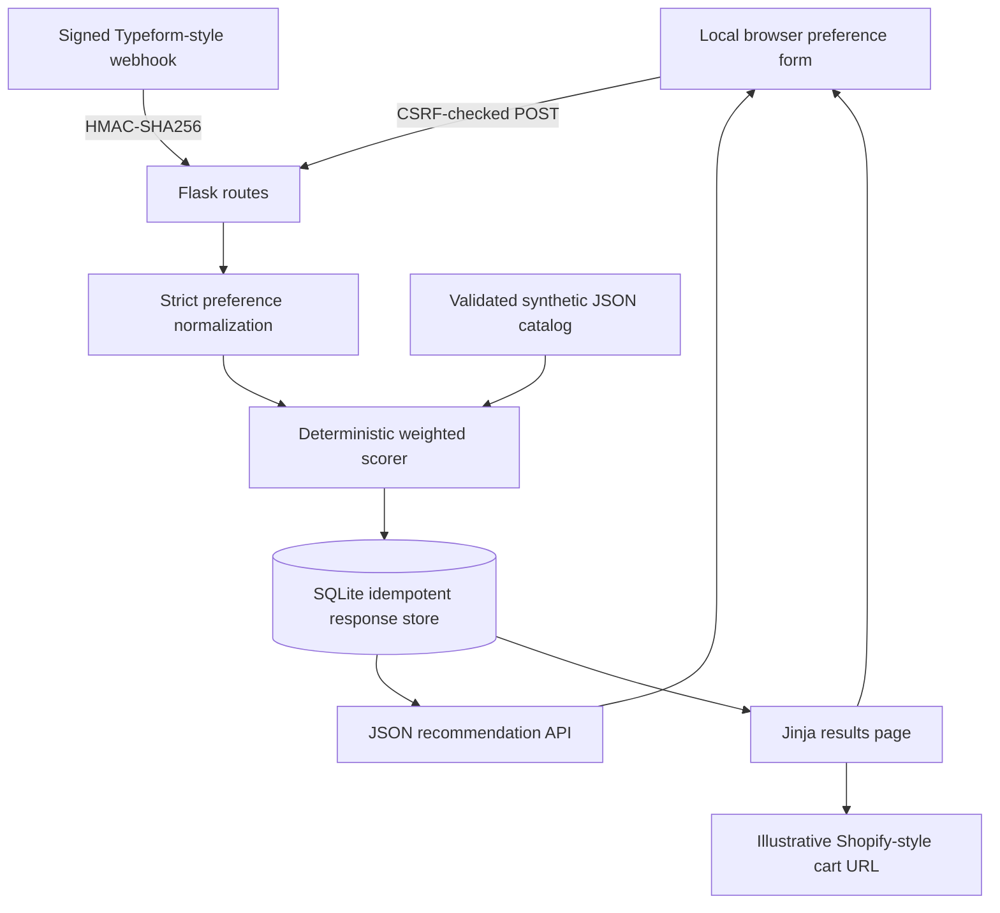
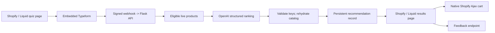

# Architecture and Data Contracts

## Components

This is the **implemented local architecture**. The production Shopify/Liquid/OpenAI flow described later is a proposal only.

## Separation of responsibilities

| Module | Responsibility |
|---|---|
| `app/__init__.py` | Explicit Flask factory, dependencies, storage initialization |
| `app/config.py` | Typed environment configuration, local/production modes, trust-boundary validation |
| `app/preferences.py` | Typeform field-ref extraction, normalization, strict vocabulary, response-ID validation |
| `app/catalog.py` | Catalog schema validation, active status, synthetic products |
| `app/recommendations.py` | Weighted scoring, tie-breaking, match reasons, cart URL formatting |
| `app/security.py` | HMAC-SHA256 Typeform verification and CORS origin validation |
| `app/storage.py` | SQLite durability, hash-based idempotency, privacy-limited record storage |
| `app/routes.py` | HTTP routes, CSRF, CORS, CSP and input boundaries |
| `app/templates/` and `app/static/` | Responsive HTML presentation and illustrative product art |

## Request lifecycle

### Local form (implemented)

1. `GET /` creates a session-backed CSRF token and renders a preference questionnaire.
2. `POST /demo/submit` checks CSRF, validates selections, normalizes aliases, and builds a `Preferences` instance.
3. The scoring engine selects active, caffeine-compatible candidates, sorts by `(-score, title.casefold(), key)`, and keeps exactly three; zero-score suggestions are marked exploratory.
4. One SQLite transaction writes the sanitized answer set, catalog digest, algorithm version, recommendation snapshot and a hashed form nonce. Concurrent repeats of the same form nonce return the original response ID; changed answers with the same nonce produce HTTP 409.
5. HTTP `303` redirects to `/results/<token>`; the results page renders a local synthetic product lineup and links to its read-only JSON representation.

### Mock Typeform webhook (implemented)

1. `POST /typeform/webhook` requires a configured secret; absent secret returns HTTP 503.
2. A signature over the **exact raw request body** is verified using constant-time comparison before parsing JSON.
3. `form_response.token` must match the restricted ID pattern and `form_response.form_id` must match the configured form ID when supplied.
4. Recognized field references are normalized into the same preference model as the local form.
5. SQLite starts `BEGIN IMMEDIATE` for a transaction-safe insert/check. Identical token + scoring-relevant normalized preferences returns success with `duplicate=true`; conflicting reuse returns HTTP 409 and leaves the saved record unchanged. Flavor-note ordering and free-text wording do not create false conflicts because neither changes the ranking; explicit structured style changes do conflict.

### Data contracts

**Input:** `brew_method`, `roast_level`, `flavor_notes` (array), `caffeine_level`, `milk_preference`, `style_preference`, and optional `extra_notes`. A request must include at least one **structured** preference; free-text notes are discarded for scoring. The supported vocabulary is defined in `app/preferences.py` and reflected by the form options.

**Typeform field refs:** `brew_method`, `flavor_notes`, `roast_level`, `caffeine_level`, `milk_preference`, `style_preference`, `extra_notes`. This is a field reference contract; a real Typeform form would need to be configured explicitly. Other answer fields, including unrelated questions without configured refs, are ignored and not stored. Duplicate known field refs or unsupported answer types on recognized fields produce an error.

**Response:** `response_id`, `status`, `created_at`, `catalog_digest`, `algorithm_version`, `preferences`, `recommendations`, and `cart_preview_only`. Each recommendation includes `rank`, `product_key`, `title`, `price`, `handle`, a **synthetic** `variant_id`, `palette`, `style`, `score`, `match_quality`, `score_breakdown`, `why`, and illustrative `cart_preview_url` / `product_preview_url` strings using the reserved `.example` domain. The API never returns raw webhook bodies or free-text notes.

**Catalog:** JSON array of products with unique `key` and `variant_id`, `title`, `handle`, decimal-string `price`, `active` boolean, `availability_type` (`always` or `monthly`), local illustration `palette`, explicit `style` category, and trait categories. The catalog must contain at least three active caffeine-compatible products for each supported caffeine choice; invalid data fails startup.

## HTTP status contract

| Route condition | Status |
|---|---|
| Healthy service | `200` |
| Signed webhook newly accepted / exact duplicate | `200` (with `duplicate` flag) |
| Unconfigured webhook secret | `503` |
| Bad webhook signature | `401` |
| Malformed webhook JSON | `400` |
| Invalid preference contract | `422` |
| Conflicting repeated webhook token | `409` |
| Invalid API response ID | `400` |
| Response ID not found | `404` |
| Oversized request body | `413` |
| Local form accepted / duplicate same nonce | `303` redirect to same record |
| Local form nonce reused with changed answers | `409` |

## Storage and privacy

SQLite stores a response identifier, submission timestamp, SHA-256 fingerprint for duplicate detection, normalized **structured** preference fields, and final ranked recommendations. It does not persist the original Typeform payload, personal contact fields, or extra free-text notes. The duplicate fingerprint uses only validated structured selections and canonicalized, order-insensitive flavor notes; no raw notes, raw-note hashes, or email addresses are retained. The stored catalog digest and algorithm version identify the recommendation snapshot. Replays of existing response tokens retain the original result even after catalog edits; new tokens use the latest validated catalog. SQLite also stores a SHA-256 hash of each random local form nonce to prevent duplicate form creates. SQLite contains demo preference records only and is ignored by Git. On POSIX systems, the database file is set to owner-only permissions (`0600`).

The response token is a bearer-capability to fetch **non-sensitive** preference selections. A public customer deployment requires an authorization/privacy design, retention policy, access logging policy, and likely a different identity model. Public error responses intentionally omit exception details and stack traces.

## Proposed production flow — NOT implemented

This future architecture would require authorized store access, real variant/catalog data, Typeform configuration, model credentials, validated three-product outputs, failure recovery, native cart integration, CORS policies and deployment. Nothing in this diagram claims that those external services were connected or tested.

## Local filesystem security boundary

The configured database path is not dereferenced before symlink checks; pre-existing symbolic links in the file or parent chain are rejected. This is a **local demo** that assumes its database directory is owned and controlled by the operator, not a defense against an adversary changing filesystem links concurrently. Public deployment requires a stronger storage and threat model.
